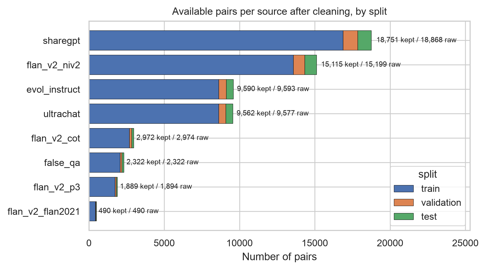
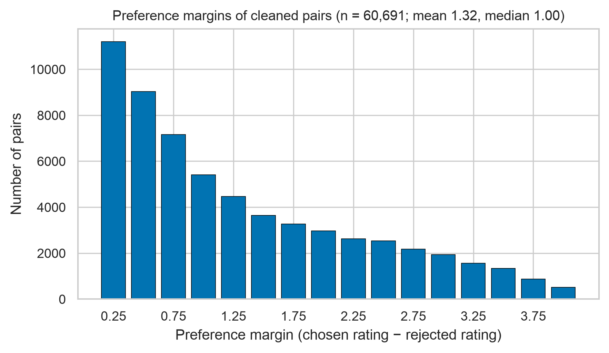
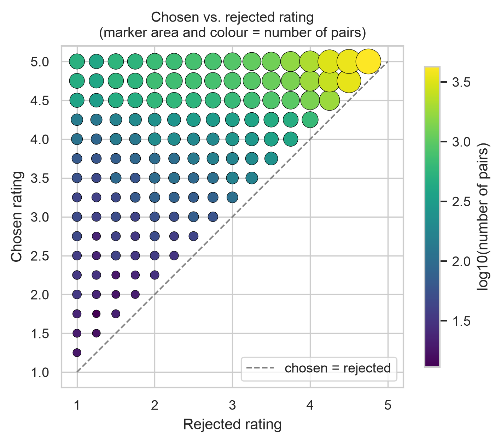
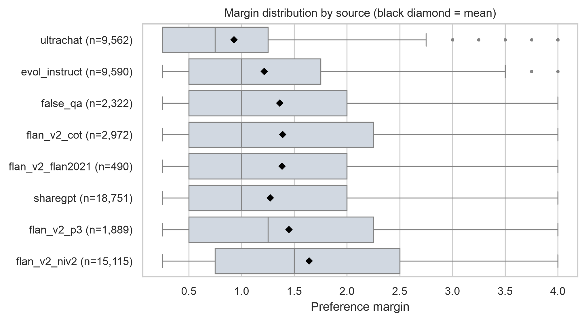
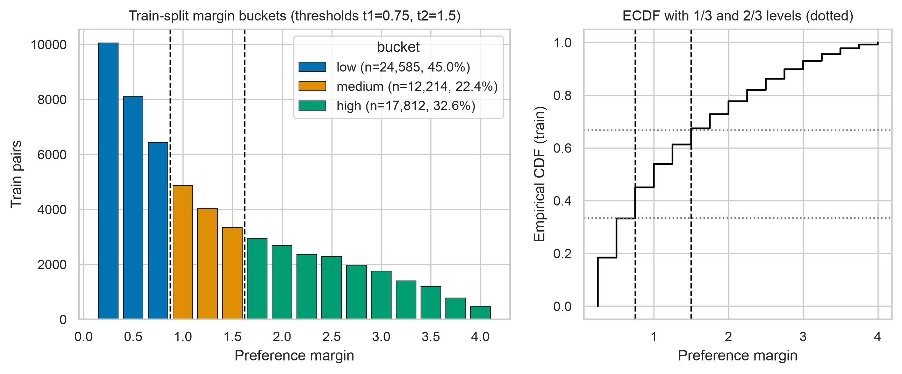
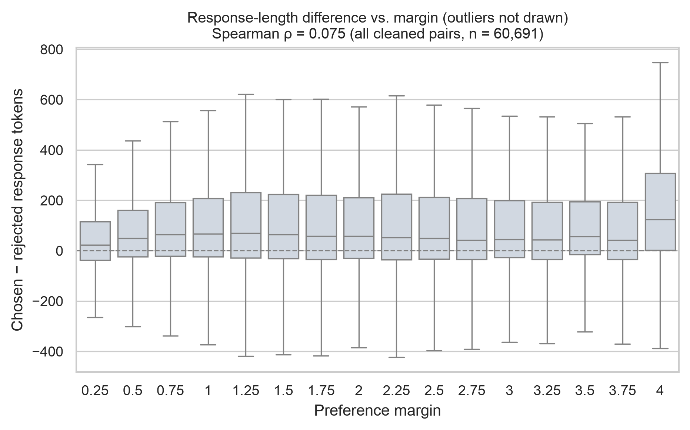
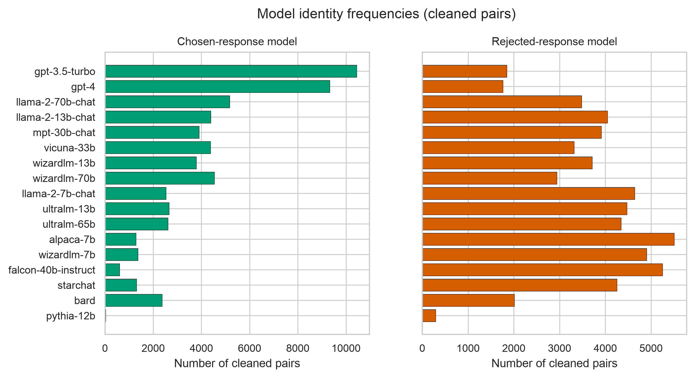

# Exploratory Data Analysis: UltraFeedback preference margins

*Dataset:* `argilla/ultrafeedback-binarized-preferences-cleaned` @ `770076f077c4` · *Tokenizer:* `Qwen/Qwen2.5-1.5B-Instruct` @ `989aa7980e4c`  
*Generated by* `scripts/eda.py` from `results/eda/analysis_summary.json`. All numbers are computed from the downloaded data.

> **Scope.** Every analysis in this report is **descriptive**. It characterises the training data; it does not show that margin (or any other variable) *causes* a difference in DPO outcomes. Causal claims require the controlled training experiments E1–E4.

## 1. Key observations

1. 60,917 raw pairs; 60,691 kept after cleaning (0.37% dropped). All raw pairs already have chosen-rating > rejected-rating.
2. Margins are discrete (steps of 0.25), right-skewed (mean 1.32, median 1.00) and concentrated at small values: margin 0.25 alone accounts for 11,197 pairs (18.4%).
3. Margin is almost entirely determined by the **rejected** rating (Spearman with rejected rating ρ = -0.887 (p < 1e-300, n = 54,611); with chosen rating ρ = -0.020 (p = 1.8e-06, n = 54,611)). Chosen responses are rated highly in every bucket (bucket means low 4.64, medium 4.57, high 4.66).
4. Train-only tercile thresholds are t1 = 0.75, t2 = 1.5. Because margins are discrete, the buckets are **not equal-sized**: low 45.0%, medium 22.4%, high 32.6% of train pairs.
5. Margin buckets differ in source mix (Cramér's V = 0.156), rejected-model identity (V = 0.234) and response length (mean rejected tokens decreases monotonically from low to high bucket). These are potential confounders for any margin effect.

## 2. Validation of schema and conversational structure

- Columns: `chosen`, `chosen-model`, `chosen-rating`, `prompt`, `rejected`, `rejected-model`, `rejected-rating`, `source`. Schema matched the expected types.
- Rows: 60,917.
- Turn patterns (chosen / rejected): `['user', 'assistant'] / ['user', 'assistant']`: 60,917.
- User turn identical to `prompt` in both chosen and rejected: 60,917 rows; chosen and rejected share all non-final turns: 60,917 rows.
- Byte-identical (after whitespace strip) chosen and rejected responses: 62 rows.
- Manual inspection of 12 seeded examples (one per source, then random; [`reports/example_inspection.md`](example_inspection.md)): shared prompt 12/12, distinct responses 12/12, prompt appears exactly once after TRL formatting 12/12.
- Because the raw `chosen`/`rejected` lists repeat the user turn, `to_dpo_example` moves it to `prompt` and keeps only the assistant message in `chosen`/`rejected`, so the prompt is not duplicated in TRL inputs.

## 3. Cleaning

Rules are applied in the order below; each dropped row records the first rule it fails (`data/splits/dropped.csv`).

| Reason | Rows | Rate (of raw) | Sources |
|---|---:|---:|---|
| `malformed_structure` | 0 | 0.000% | – |
| `malformed_rating` | 0 | 0.000% | – |
| `empty_prompt` | 0 | 0.000% | – |
| `empty_chosen` | 1 | 0.002% | flan_v2_niv2 1 |
| `empty_rejected` | 8 | 0.013% | flan_v2_niv2 6, sharegpt 2 |
| `identical_responses` | 62 | 0.102% | flan_v2_niv2 56, flan_v2_p3 5, sharegpt 1 |
| `non_positive_margin` | 0 | 0.000% | – |
| `overlong` | 119 | 0.195% | evol_instruct 3, flan_v2_cot 2, flan_v2_niv2 10, sharegpt 89, ultrachat 15 |
| `duplicate_normalized_prompt` | 36 | 0.059% | flan_v2_niv2 11, sharegpt 25 |
| **total** | **226** | **0.371%** | |

- *Duplicates:* 33 normalized-prompt groups covering 69 rows; 22 of these groups differ in raw text and are only detected after normalization (NFKC, lowercase, whitespace collapse). The lowest original index is kept; 36 rows dropped.
- *Overlong:* pairs whose full chat-templated sequence (incl. Qwen's default system prompt) exceeds 2048 tokens for either response are dropped, so training never truncates a response.
- *Identical responses* received different ratings despite identical text. For such a pair the DPO chosen/rejected log-ratio difference is always zero, so it contributes no gradient; they are dropped.
- Very short responses are **kept** because they are valid answers to label-style prompts: 2,846 kept pairs have a response of at most 2 tokens, of which flan_v2_niv2 2,434, flan_v2_p3 221, sharegpt 62.

## 4. Leakage-safe splits

Kept pairs are assigned to splits by a salted SHA-256 of the normalized prompt (seed 0), so assignment is independent of row order and a prompt cannot appear in more than one split.

| Split | Pairs | Unique prompts | Fraction |
|---|---:|---:|---:|
| train | 54,611 | 54,611 | 89.98% |
| validation | 3,075 | 3,075 | 5.07% |
| test | 3,005 | 3,005 | 4.95% |

Prompt overlap between splits: train&validation = 0, train&test = 0, validation&test = 0. Manifest SHA-256 checksums are in `data/splits/SHA256SUMS`. Mean margin by split: train 1.317, validation 1.313, test 1.308.



*Figure 5. Kept pairs per source, stacked by split; labels give kept/raw counts.*

## 5. Ratings and margins



*Figure 1. Margin distribution of the 60,691 cleaned pairs.*

Chosen ratings: mean 4.63, median 4.75, IQR [4.50, 5.00]. Rejected ratings: mean 3.32, median 3.50, IQR [2.50, 4.25]. The rejected rating is far more variable (SD 1.09 vs 0.48), which is why it drives the margin. Chosen and rejected ratings are positively correlated (ρ = 0.403 (p < 1e-300, n = 60,691)).



*Figure 2. Chosen vs. rejected rating. All mass lies above the diagonal (positive margin); the densest cells are high chosen ratings paired with high rejected ratings, i.e. small margins.*

## 6. Margin by source



*Figure 3. Margin by source, ordered by median.*

| Source | Kept | Mean margin | Median | Mean chosen / rejected rating | Mean tokens chosen / rejected | Train share low / med / high |
|---|---:|---:|---:|---|---|---|
| ultrachat | 9,562 | 0.93 | 0.75 | 4.85 / 3.92 | 458 / 321 | 62% / 22% / 16% |
| evol_instruct | 9,590 | 1.21 | 1.00 | 4.70 / 3.48 | 412 / 323 | 48% / 24% / 28% |
| sharegpt | 18,751 | 1.27 | 1.00 | 4.75 / 3.48 | 397 / 280 | 46% / 23% / 31% |
| false_qa | 2,322 | 1.36 | 1.00 | 4.56 / 3.19 | 148 / 111 | 46% / 20% / 34% |
| flan_v2_flan2021 | 490 | 1.38 | 1.00 | 4.58 / 3.19 | 131 / 116 | 41% / 24% / 35% |
| flan_v2_cot | 2,972 | 1.39 | 1.00 | 4.56 / 3.17 | 154 / 118 | 43% / 21% / 35% |
| flan_v2_p3 | 1,889 | 1.45 | 1.25 | 4.60 / 3.15 | 113 / 83 | 41% / 21% / 38% |
| flan_v2_niv2 | 15,115 | 1.64 | 1.50 | 4.34 / 2.70 | 99 / 101 | 32% / 22% / 46% |

The lowest mean margin is in `ultrachat` (0.93) and the highest in `flan_v2_niv2` (1.64). Margin-based selection therefore implicitly re-weights sources: `flan_v2_niv2` makes up 35.0% of the high bucket vs 17.9% of the low bucket, and `ultrachat` makes up 7.6% vs 21.7%.

## 7. Thresholds for margin buckets (train split only)



*Figure 6. Left: train margins coloured by bucket, dashed lines between buckets. Right: train ECDF; dotted lines mark the 1/3 and 2/3 levels.*

- Rule: low: margin <= t1; medium: t1 < margin <= t2; high: margin > t2; thresholds are the 0.3333 and 0.6667 quantiles of the train margins: t1 = 0.75, t2 = 1.5.
- Bucket membership by margin value (train): low: {0.25, 0.5, 0.75}; medium: {1, 1.25, 1.5}; high: {1.75, 2, 2.25, 2.5, 2.75, 3, 3.25, 3.5, 3.75, 4}.
- Bucket sizes: train: low 24,585, medium 12,214, high 17,812; validation: low 1,414, medium 643, high 1,018; test: low 1,382, medium 661, high 962.
- **Boundary sensitivity.** The train ECDF at margin 0.5 is 0.3324, just below the 1/3 level (0.3333). Because all mass at a margin value sits in one bucket, the low bucket contains 45.0% of train pairs and the medium bucket only 22.4%. A small change in the data could move t1 by one step.
- The thresholds are identical under numpy quantile methods linear, lower, higher, nearest, midpoint (linear: [0.75, 1.5]; lower: [0.75, 1.5]; higher: [0.75, 1.5]; nearest: [0.75, 1.5]; midpoint: [0.75, 1.5]).
- Equal-size training subsets are still possible because each condition samples a fixed number of pairs from its bucket, and every bucket is larger than the planned subset size.

## 8. Response length



*Figure 4. Chosen-minus-rejected response tokens per margin value (boxes: IQR, whiskers: 1.5 IQR; outliers hidden).*

- Response tokens: chosen median 266 (mean 302), rejected median 162 (mean 227); prompt (templated) median 107.
- The chosen response is longer in 65.0% of pairs (equal length in 0.9%); median difference 49 tokens. The fraction of pairs with a longer chosen response is 64.4% (low), 66.7% (medium), 64.7% (high) across train margin buckets, so this length asymmetry is present at every margin level.
- Train-split Spearman correlations with margin: length difference ρ = 0.074 (p = 3.0e-67, n = 54,611) (negligible); chosen tokens ρ = -0.138 (p = 2.1e-229, n = 54,611) (weak); rejected tokens ρ = -0.249 (p < 1e-300, n = 54,611) (weak); prompt tokens ρ = 0.110 (p = 6.5e-146, n = 54,611) (weak). With n this large, p-values are tiny even for negligible effects; the effect sizes are what matter.

## 9. Model identity



*Figure 7. How often each of the 17 models produced the chosen (left) and rejected (right) response.*

- Share of a model's appearances in which it is the chosen response — highest: `gpt-3.5-turbo` 85.0%, `gpt-4` 84.1%, `wizardlm-70b` 60.7%; lowest: `pythia-12b` 8.7%, `falcon-40b-instruct` 10.3%, `alpaca-7b` 19.0%.
- Pairs where both responses come from the same model: 0.
- Bucket vs rejected model: Cramér's V = 0.234; bucket vs chosen model: V = 0.056. Most common rejected models — low: ultralm-65b, mpt-30b-chat, ultralm-13b; medium: alpaca-7b, wizardlm-7b, falcon-40b-instruct; high: falcon-40b-instruct, alpaca-7b, llama-2-7b-chat.
- Overall chosen-share of each bucket's three most common rejected models — low: ultralm-65b 37.5%, mpt-30b-chat 49.9%, ultralm-13b 37.2%; medium: alpaca-7b 19.0%, wizardlm-7b 21.7%, falcon-40b-instruct 10.3%; high: falcon-40b-instruct 10.3%, alpaca-7b 19.0%, llama-2-7b-chat 35.3%. Model identity therefore co-varies with margin bucket.

## 10. Potential confounders by margin bucket (train split)

| | low | medium | high | trend low→high |
|---|---:|---:|---:|---|
| pairs | 24,585 | 12,214 | 17,812 |  |
| mean margin | 0.46 | 1.22 | 2.56 | increases monotonically |
| mean chosen rating | 4.64 | 4.57 | 4.66 | is non-monotonic |
| mean rejected rating | 4.18 | 3.36 | 2.09 | decreases monotonically |
| mean prompt tokens | 172 | 183 | 207 | increases monotonically |
| mean chosen tokens | 330 | 317 | 255 | decreases monotonically |
| mean rejected tokens | 273 | 224 | 164 | decreases monotonically |
| mean length diff | 57 | 93 | 91 | is non-monotonic |
| median length diff | 41 | 68 | 52 | is non-monotonic |
| chosen longer | 64.4% | 66.7% | 64.7% | is non-monotonic |

Source mix differs across buckets (χ² = 2663, dof = 14, Cramér's V = 0.156).

**Implications for the experiments (design, not results):**

- E2 (high) vs E4 (low) changes margin *together with* rejected-response quality, rejected-model identity, source mix and absolute response lengths. A performance difference between them cannot be attributed to margin alone.
- Possible controls to consider: source-stratified sampling within buckets, matching on response length, reporting per-source evaluation, or an additional condition that varies margin at fixed rejected-rating range.
- The unequal bucket sizes do not affect training budget (each condition uses the same subset size), but the medium bucket offers the smallest candidate pool (12,214 train pairs).

## 11. What is descriptive and what is not

- **Descriptive (this report):** counts, filtering rates, distributions, correlations, and associations between margin and source/length/model. These describe the dataset only.
- **Not shown here:** whether training on any bucket improves a model, or why. Correlations between margin and length or source do not imply that either drives DPO outcomes.
- **Rating provenance:** per the dataset card, pairs were binarized using the *average of the preference ratings* (consistent with the observed 0.25 steps). UltraFeedback ratings come from GPT-4 annotation, so margin measures differences in an automatic judge's scores, not human preference strength.
- **p-values:** with tens of thousands of pairs almost any association is "significant"; we report effect sizes (Spearman ρ, Cramér's V) and avoid interpreting p-values as importance.

## Reproduction

```bash
python scripts/prepare_data.py   # validation, cleaning, splits, checksums
python scripts/eda.py            # summary JSON, figures, this report
```
